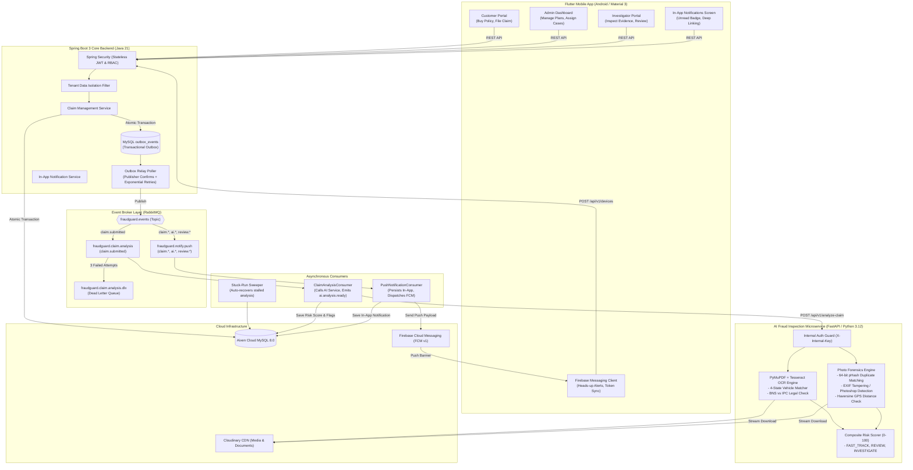

# 🛡️ FraudGuard — Automated Insurance Claim Fraud Investigator

[](https://flutter.dev)
[](https://www.oracle.com/java/)
[](https://spring.io/projects/spring-boot)
[](https://www.python.org/)
[](https://fastapi.tiangolo.com/)
[](https://www.rabbitmq.com/)
[](https://firebase.google.com/)
[](https://www.mysql.com/)
[](https://www.docker.com/)
[-brightgreen?logo=android&logoColor=white)](https://github.com/v1-n/Automated-Insurance-Claim-Fraud-Investigator/releases/download/v1.1.0/FraudGuard-v1.1.0.apk)

FraudGuard is an enterprise, multi-tenant automated insurance claim management and AI-powered fraud investigation platform. Built with **Spring Boot 3 (Java 21)** on the core backend, **RabbitMQ** for event-driven decoupled pipelines, **FastAPI (Python 3.12)** for computer vision and OCR fraud forensics, and **Flutter** on mobile, it automates the full motor policy lifecycle, incident claim filing, multi-modal evidence analysis, real-time push/in-app alerts, and investigator casework.

---

## 📱 Download Android APK (Live Demo)

👉 **[Download FraudGuard Android APK (v1.1.0)](https://github.com/v1-n/Automated-Insurance-Claim-Fraud-Investigator/releases/download/v1.1.0/FraudGuard-v1.1.0.apk)**  
*(File size: ~58.6 MB, configured with live Render production backend, FCM push alerts, and in-app notifications)*

> 📦 **All Releases**: View release notes and previous builds on the [GitHub Releases page](https://github.com/v1-n/Automated-Insurance-Claim-Fraud-Investigator/releases).

---

## 🔑 Demo Login Credentials

You can test all 3 roles using these pre-configured credentials:

| Role | Email | Password | Tenant | Capabilities |
| :--- | :--- | :--- | :--- | :--- |
| **Admin** | `admin@fraudguard.com` | `admin123` | `TATA_AIG` | Create insurance plans, view all claims, assign investigators |
| **Investigator** | `investigator01@fraudguard.com` | `investigator123` | `TATA_AIG` | Review assigned claims, inspect evidence photos/FIRs, submit fraud reports |
| **Customer** | `customer@fraudguard.com` | `customer123` | `TATA_AIG` | Browse plans, activate vehicle policies (MH-12-AB-1234), file claims |

> **Note:** The backend is deployed live on Render: `https://fraudguard-backend-g3e4.onrender.com`. (Free tier backend may take 30-45 seconds to spin up on cold start).

---

## 🏗️ System Architecture



---

## ✨ Key Features

### 1. Multi-Tenant Architecture & RBAC
* Complete data isolation per insurance tenant (`TATA_AIG`, `MAHI`, `MSIL`).
* Stateless JWT authentication with `@PreAuthorize` method security.

### 2. Transactional Outbox & Event-Driven Reliability
* **Transactional Outbox Pattern**: Eliminates dual-write failure modes by atomically committing business records and outbox events in the same MySQL transaction.
* **Correlated Publisher Confirms**: `OutboxRelay` verifies positive broker ACKs before marking outbox records `PUBLISHED`.
* **Dead Letter Queue (DLQ)**: Retries transient AI inspection failures up to 3 times with exponential backoff (5s, 15s, 45s) before isolating to `fraudguard.claim.analysis.dlx`.
* **Stuck-Run Sweeper**: Automatically audits and recovers claims stuck in `PENDING_ANALYSIS`.

### 3. Multi-Modal AI Fraud Inspection
* **4-State Vehicle Registration Matcher**: Classifies matches into `MATCH` (clean), `NEAR` (minor OCR substitution), `MISMATCH` (conflicting license plate detected), or `NOT_FOUND`.
* **Cross-Claim Duplicate Photo Detection**: 64-bit Perceptual Hashing (pHash) with Hamming distance matching flags identical or cropped/re-saved photos across different claims and policies.
* **Photo EXIF & Tampering Forensics**: Detects photo manipulation software (Photoshop, GIMP, Canva) and checks camera make/model.
* **Graduated Timeline & GPS Distance**: Compares photo capture timestamps (IST) and EXIF GPS coordinates against claimed incident dates and locations ($>50\text{ km}$ distance threshold).
* **Legal Code Modernization**: Flags post-July-2024 FIRs that cite obsolete Indian Penal Code (IPC) sections instead of Bharatiya Nyaya Sanhita (BNS).

### 4. Push & In-App Notification Hub
* **Firebase Cloud Messaging (FCM v1)**: Sends real-time heads-up notification banners to Android devices on critical events (`claim.submitted`, `claim.assigned`, `ai.analysis.ready`, `review.submitted`, `claim.approved`, `claim.rejected`).
* **In-App Notification Center**: Live inbox with dynamic unread counter badge on the mobile dashboard bell icon.
* **Smart Deep-Linking**: Tapping an in-app notification navigates directly to the role-specific claim screen (`ClaimDetailScreen`, `InvestigationDetailScreen`, or `AdminClaimDetailScreen`).
* **Event Idempotency**: Deduplicates notifications by `(eventId, recipientId)` to prevent duplicate inbox entries.

### 5. Motor Policy Lifecycle & Investigation Governance
* **Admin Master Plan Catalog**: Admins configure coverage limits (IDV) and annual premiums.
* **Vehicle Policy Activation**: Customers apply a plan to a specific vehicle registration number and make/model.
* **Composite Risk Scoring**: Calculates claim risk score from $0$ to $100$ and assigns recommendations (`FAST_TRACK`, `REVIEW`, `INVESTIGATE`).
* **Explainable Evidence Flags**: Generates IRDAI-compliant structured evidence flags with benign explanations and recommended next steps for investigators.
* **Admin Gated Decision**: Final claim approval or rejection is gated until investigation review is completed.

---

## 🛠️ Tech Stack

* **Mobile App:** Flutter 3.x, Dart, Provider (State Management), Firebase Messaging, `flutter_local_notifications`, Material 3, HTTP Client
* **Backend Core:** Java 21, Spring Boot 3, Spring Data JPA / Hibernate, Spring Security (JWT), Spring AMQP (RabbitMQ)
* **Message Broker:** RabbitMQ 3.x (CloudAMQP in production)
* **AI Fraud Service:** Python 3.12, FastAPI, PyMuPDF, Tesseract OCR, PIL/Pillow, ImageHash, ExifRead, httpx
* **Database:** MySQL 8.0 on Aiven Cloud
* **Cloud & DevOps:** Docker, Render, Cloudinary (File Storage), Firebase Admin SDK (FCM)

---

## 🚀 Cloud Deployment Guide (Render)

### 1. RabbitMQ Broker (CloudAMQP)
1. Create a free **Little Lemur** shared instance on [CloudAMQP](https://www.cloudamqp.com/).
2. Copy the host, port, username, and password into your environment variables.

### 2. Deploy AI Fraud Microservice on Render
1. Create a new **Web Service** on Render pointing to your GitHub repository (`dev` or `main`).
2. Set **Root Directory** to `fraudguard-ai-service`.
3. Set **Runtime** to `Docker` (Render automatically uses `fraudguard-ai-service/Dockerfile`).
4. Add Environment Variables:
   ```env
   PORT=8000
   AI_INTERNAL_KEY=your-secure-shared-secret-key
   ```
5. Note the deployed URL (e.g. `https://fraudguard-ai-service.onrender.com`).

### 3. Deploy Spring Boot Backend on Render
1. Create a new **Web Service** on Render.
2. Set **Root Directory** to `fraudguard-backend`.
3. Set **Runtime** to `Docker` (uses `fraudguard-backend/Dockerfile`).
4. Add Environment Variables:
   ```env
   SERVER_PORT=8081
   DB_URL=jdbc:mysql://<aiven-mysql-host>:3306/insurance_fraud_db?useSSL=false&serverTimezone=UTC&allowPublicKeyRetrieval=true
   DB_USER=root
   DB_PASSWORD=<your-db-password>
   JWT_SECRET=<your-64-char-jwt-secret>
   
   # AI Service Connection
   AI_SERVICE_URL=https://fraudguard-ai-service.onrender.com/api/v1/analyze-claim
   AI_FRAUD_SERVICE_INTERNAL_KEY=your-secure-shared-secret-key

   # RabbitMQ Connection (CloudAMQP)
   RABBITMQ_HOST=<your-cloudamqp-host>
   RABBITMQ_PORT=5672
   RABBITMQ_USER=<your-cloudamqp-user>
   RABBITMQ_PASSWORD=<your-cloudamqp-password>

   # Storage Provider (Cloudinary)
   STORAGE_PROVIDER=cloudinary
   CLOUDINARY_CLOUD_NAME=<your-cloud-name>
   CLOUDINARY_API_KEY=<your-api-key>
   CLOUDINARY_API_SECRET=<your-api-secret>

   # Firebase Push Notifications (Paste raw JSON or upload via Render Secret File)
   FIREBASE_CREDENTIALS_JSON=<full-firebase-adminsdk-json-string>
   ```

---

## 💻 Local Setup & Build

### 1. Run RabbitMQ via Docker
```bash
docker run -d --name rabbitmq -p 5672:5672 -p 15672:15672 rabbitmq:3-management
```

### 2. Run Python AI Fraud Microservice
```bash
cd fraudguard-ai-service
python3 -m venv venv
source venv/bin/activate
pip install -r requirements.txt
cp .env.example .env
uvicorn app.main:app --reload --port 8000
```

### 3. Run Spring Boot Backend
```bash
cd fraudguard-backend
mvn clean spring-boot:run
```

### 4. Run Flutter Mobile App
```bash
cd fraudguard-mobile
flutter pub get
flutter run
```

---

## 📚 Documentation Index

Detailed architectural and technical documents are available in the [`docs/`](docs/) directory:
- [System Architecture & Event Pipelines](docs/architecture/system-design.md) — Service boundaries, Outbox pattern, sequence diagrams, and DLQ specifications.
- [API Documentation](docs/api/api-documentation.md) — Complete endpoint specs, schemas, and flag taxonomies.
- [Database Schema Design](docs/architecture/database-design.md) — ERD diagrams, entities, and perceptual hash storage.
- [Project Memory & Milestones](docs/Memory.md) — Current state, completed features, and implementation roadmap.

---

## 👤 Author
**Vivek Narawade**  
* B.Tech in Artificial Intelligence & Data Science, AISSMS IOIT, Pune  
* [LinkedIn](https://www.linkedin.com/in/vivek-narawade-095a6431b/) • [GitHub](https://github.com/viveknarawade)