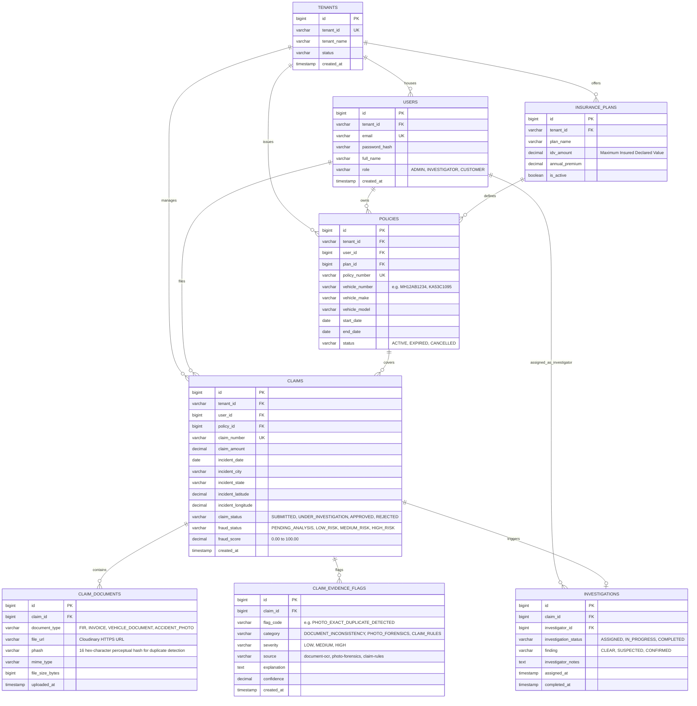

# FraudGuard Database Architecture & Schema Design 🗄️

This document details the entity-relationship model and schema specifications for **FraudGuard** (MySQL 8.0 on Aiven Cloud).

---

## 📊 Entity Relationship Diagram (ERD)

---

## 🔑 Key Field Details for Fraud Intelligence

### 1. `claim_documents.phash` (Perceptual Hash Column)
- **Type**: `VARCHAR(16)`
- **Format**: 16 lowercase hexadecimal characters (e.g. `9eb67138673361a8`).
- **Purpose**: Enables $O(1)$ lookup for exact duplicate photos and Hamming distance comparisons for cross-claim image re-use detection across multiple policies and tenants.

### 2. `claims.fraud_score` & `claims.fraud_status`
- **`fraud_score`**: Numeric value between `0` and `100` computed by the AI microservice composite scoring formula.
- **`fraud_status`**:
  - `PENDING_ANALYSIS`: Initial state upon submission before AI processing completes.
  - `LOW_RISK`: Score $< 25$ with no medium/high flags (eligible for Fast-Track auto approval).
  - `MEDIUM_RISK`: Score $25 - 59$ or presence of a medium flag (desktop review required).
  - `HIGH_RISK`: Score $\ge 60$ or any high severity flag (investigator assignment mandatory).
