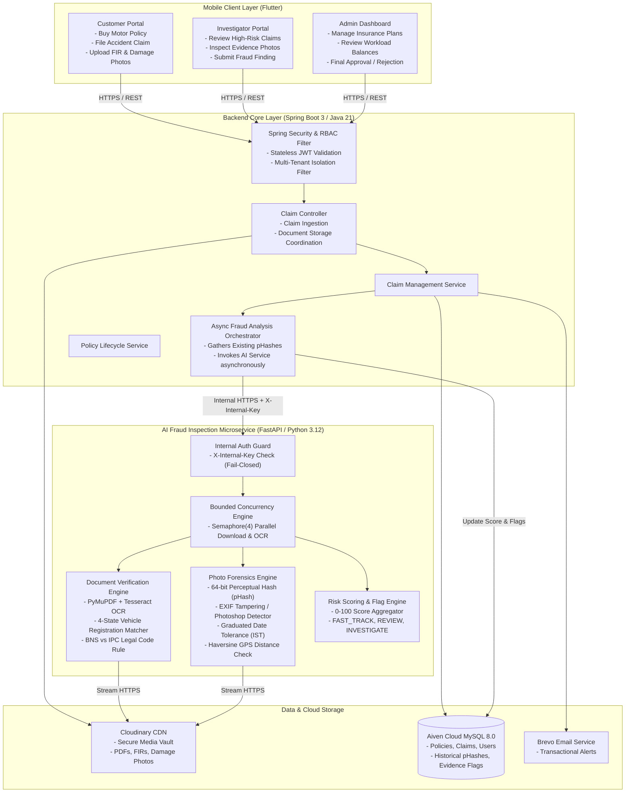

# FraudGuard System Architecture & Design 🏗️

This document details the multi-modal architecture, service boundaries, and asynchronous data pipelines of the **FraudGuard** platform.

---

## 🏛️ 1. Multi-Tier Architecture Diagram

---

## 🔄 2. End-to-End Claim Intake & Fraud Analysis Flow

1. **Claim Submission**:
   - Customer submits claim details via Flutter app, including incident date, location, vehicle number, and uploads accident damage photos and police FIR documents.
   - Files are stored in Cloudinary, returning public secure HTTPS URLs.
2. **Initial Persistence in Spring Boot**:
   - Spring Boot saves the claim with status `PENDING_ANALYSIS` and initial risk score `0`.
3. **Asynchronous Fraud Inspection Trigger**:
   - Spring Boot queries recent photo hashes (`existing_hashes`) from the `claim_documents` table.
   - Spring Boot constructs an `AnalyzeClaimRequest` payload and sends it asynchronously to `POST /api/v1/analyze-claim` with header `X-Internal-Key: <secret>`.
4. **AI Microservice Multi-Modal Evaluation**:
   - **Internal Auth**: FastAPI verifies constant-time `hmac.compare_digest` on `X-Internal-Key`.
   - **Concurrent Processing**: Documents and photos are downloaded and processed concurrently in bounded batches of 4.
   - **Document Processing**: OCR extracts text; the 4-state vehicle matcher checks the ground-truth registration; IPC/BNS compliance is checked.
   - **Photo Forensics**: Computes 64-bit pHash; compares against existing hashes with Hamming distance; inspects EXIF for editing software; checks photo date and GPS distance against claimed incident.
   - **Claim Rules**: Evaluates policy coverage dates, IDV limits, and future date checks in India Standard Time (`Asia/Kolkata`).
   - **Composite Score Aggregation**: Generates score (0–100), risk tier (`LOW`, `MEDIUM`, `HIGH`), recommendation (`FAST_TRACK`, `REVIEW`, `INVESTIGATE`), and structured evidence flags.
5. **Persistence of Results**:
   - Spring Boot receives `AnalyzeClaimResponse`.
   - Updates `claims.fraud_score`, `claims.fraud_status`, persists evidence flags, and stores generated `phash` in `claim_documents` for future cross-claim duplicate matching.
   - If `risk_level == HIGH`, an alert is dispatched to investigators.

---

## 🔒 3. Security Architecture

1. **Stateless JWT with RBAC**:
   - Customer, Investigator, and Admin roles are enforced via `@PreAuthorize("hasRole('ROLE_...')")`.
   - Multi-tenant tenant ID header isolates database rows automatically.
2. **Internal Microservice Authentication (`X-Internal-Key`)**:
   - Python FastAPI endpoints are protected by a shared secret.
   - Fails closed in production: if `AI_INTERNAL_KEY` is missing, requests return HTTP 503.
   - Constant-time comparison prevents timing side-channel attacks.
3. **Downloader Hardening & SSRF Prevention**:
   - Only HTTPS downloads permitted (`http://` rejected).
   - Domain allowlist enforced (`res.cloudinary.com`, `cloudinary.com`).
   - Redirects disabled (`follow_redirects=False`) to prevent open redirect attacks.
   - Streamed downloads with a strict 25 MB cap prevent out-of-memory (OOM) attacks.
