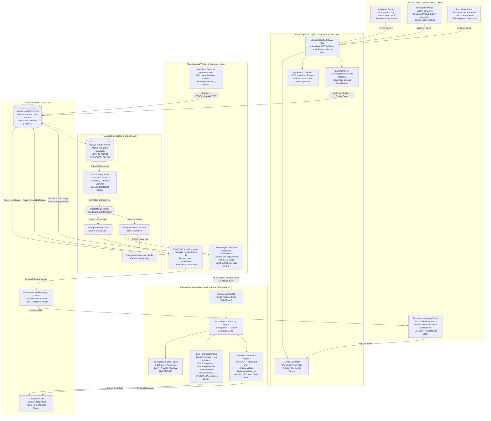
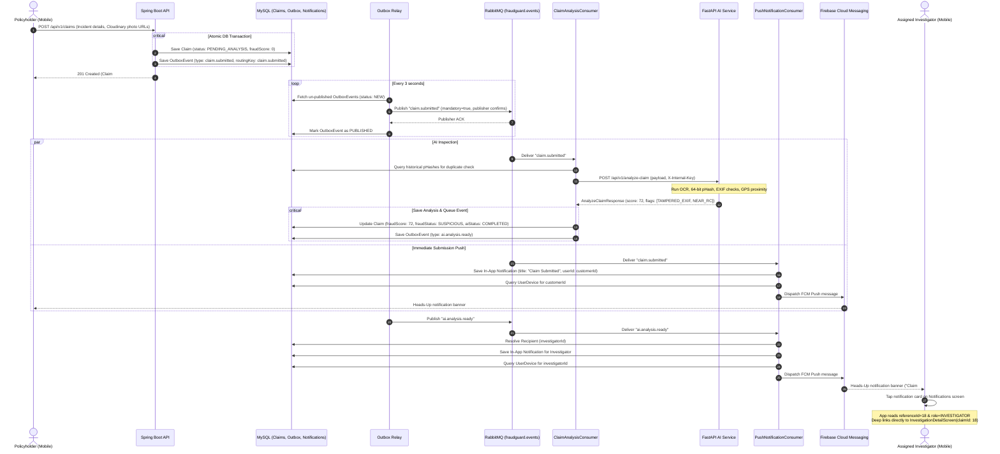

# FraudGuard System Architecture & Design 🏗️

This document details the multi-modal, event-driven architecture, service boundaries, and asynchronous data pipelines of the **FraudGuard** platform.

---

## 🏛️ 1. Multi-Tier Event-Driven Architecture Diagram

---

## 🔄 2. End-to-End Claim Intake, AI Analysis & Notification Flow

---

## 🛡️ 3. Reliability & Fault-Tolerance Mechanisms

### 3.1 Transactional Outbox Pattern
- Prevents the **dual-write problem** where a database transaction commits but the network message broker call fails.
- All domain events (`claim.submitted`, `claim.assigned`, `ai.analysis.ready`, `review.submitted`, `claim.approved`, `claim.rejected`) are persisted inside the local MySQL database transaction within the `outbox_events` table.
- A dedicated scheduled relay (`OutboxRelay`) polls un-published events, publishes them to RabbitMQ using **correlated publisher confirms**, and marks them `PUBLISHED` only after positive broker acknowledgment.

### 3.2 Dead-Letter Queue (DLQ) & 3-Strike Retry
- The RabbitMQ consumer is configured with **exponential backoff retry** (5s, 15s, 45s).
- If the AI microservice is temporarily down, the message retries 3 times.
- Upon 3 successive failures, the message is routed to `fraudguard.claim.analysis.dlx` (Dead Letter Queue) rather than being dropped or causing consumer thread lockup.

### 3.3 Stuck-Run Sweeper
- A background scheduler inspects claims lingering in `PENDING_ANALYSIS` beyond the configured timeout threshold.
- Automatically resets the state or requeues the analysis event, guaranteeing that no claim is permanently trapped in an unanalyzed state.

### 3.4 In-App Notification Idempotency & Deduplication
- `PushNotificationConsumer` verifies `existsByEventIdAndUser_UserId(eventId, recipientId)` before inserting into the `notifications` table.
- Prevents duplicate notification entries if RabbitMQ redelivers an unacknowledged message.

---

## 🔒 4. Production Security Architecture

1. **Stateless JWT with RBAC & Multi-Tenant Isolation**:
   - Enforced across endpoints via Spring Security and `@PreAuthorize`.
   - Automatic multi-tenant tenant ID filtering ensures strict company isolation (`TATA_AIG`, `MAHI`, etc.).
2. **Fail-Closed Microservice Authentication (`X-Internal-Key`)**:
   - The FastAPI AI microservice validates the secret using `hmac.compare_digest` to prevent timing attacks.
   - If `AI_INTERNAL_KEY` is not configured, the service responds with HTTP 503 instead of falling back to insecure defaults.
3. **Flexible Production Firebase Credential Discovery**:
   - Spring Boot checks:
     1. `FIREBASE_CREDENTIALS_JSON` environment variable (raw JSON string or Base64 encoded).
     2. `FIREBASE_CONFIG_PATH` file path (supporting Render Secret Files e.g., `/etc/secrets/firebase-adminsdk.json`).
     3. Local development classpath fallback (`ClassPathResource`).
   - Ensures zero private key exposure in git while supporting seamless container deployment.
4. **Hardened Asset Ingestion**:
   - Streamed downloads with a 25 MB byte cap to prevent memory exhaustion (OOM).
   - Domain allowlist (`res.cloudinary.com`, `cloudinary.com`) and open-redirect protection (`follow_redirects=False`) preventing SSRF.
