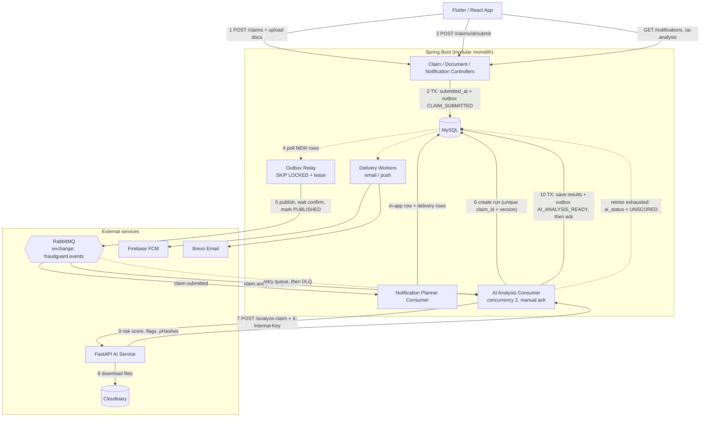
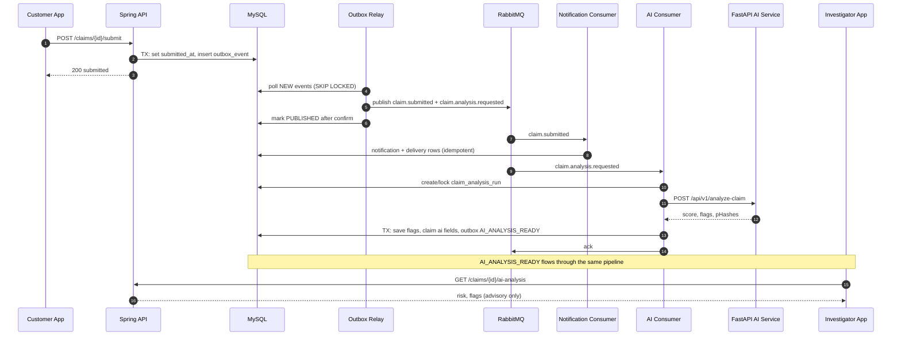
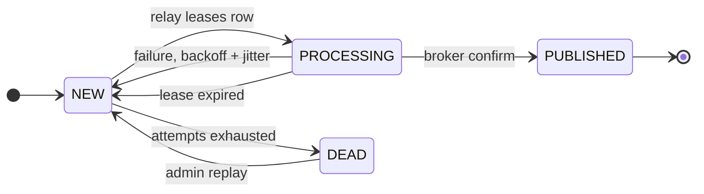
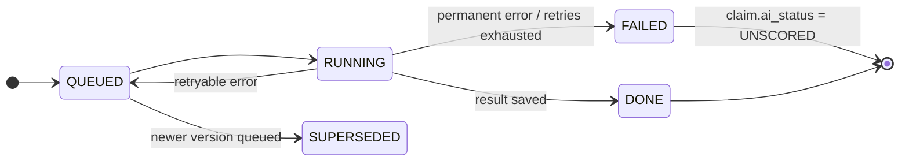
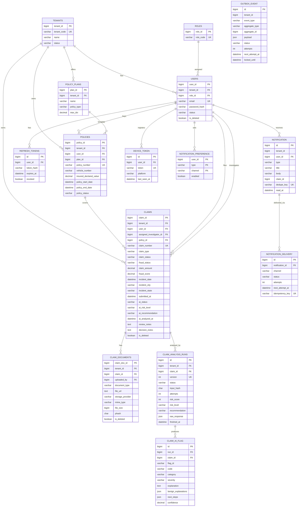

# FraudGuard — System Design & Database Design (diagrams)

Render with any Markdown viewer that supports Mermaid (GitHub, VS Code + Markdown Preview Mermaid Support, Obsidian).
Broker variant: RabbitMQ. Column lists for existing tables are simplified; verify against the entities.

## 1. System architecture

## 2. Claim submit to AI result (sequence)

## 3. State machines

## 4. Database design (ER diagram)

## 5. Key indexes and constraints

| Table | Index / constraint | Purpose |
|---|---|---|
| `outbox_event` | `(status, next_attempt_at, id)` | relay polling |
| `notification` | `UNIQUE (dedupe_key)` | no duplicate notifications on re-run |
| `notification` | `(user_id, read_at, created_at)` | unread list and count |
| `notification_delivery` | `UNIQUE (idempotency_key)` | no duplicate email/push |
| `notification_delivery` | `(status, next_attempt_at)` | delivery polling |
| `claim_analysis_runs` | `UNIQUE (claim_id, version)` | idempotent AI runs |
| `claim_documents` | `(tenant_id, phash)` | cross-claim duplicate photo lookup |
| `claim_ai_flag` | `(claim_id)`, `(run_id)` | flag lookups |
| `device_token` | `UNIQUE (token)` | one row per device |

## 6. Rules

- Spring Boot is the source of truth. The AI service never reads this database.
- Only `outbox_event` is written inside business transactions. Everything else is derived by consumers.
- AI writes only `fraud_score`, `ai_*` columns and `claim_ai_flag`. It never changes `claim_status` or `fraud_status`.
- Every query is tenant-scoped (`tenant_id`).
- Push payloads carry ids only, never PII, amounts or verdicts.